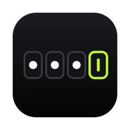

<p align="center">
  
</p>

<h1 align="center">Nexio</h1>

<p align="center">
  OTP codes from your Android phone's SMS, on your Mac's clipboard, in a couple of seconds.
</p>

---

Nexio is a tiny two-part tool:

- an **Android app** that watches incoming SMS, detects one-time passwords (OTP / 2FA / bank dynamic codes), and sends **only the code** to your Mac, end-to-end encrypted;
- a **macOS background agent** that receives the code, copies it to the clipboard and shows a notification, so you can just press <kbd>⌘</kbd><kbd>V</kbd>.

It works when the phone and Mac are on the same Wi-Fi **and** when they aren't (mobile data, different networks, changing IPs).

## Features

- **Automatic OTP detection.** Keyword + nearest-number heuristic that handles English and Persian messages, Persian/Arabic-Indic digits (۱۲۳۴), and ignores amounts (`1,250,000`), card numbers (`6104-33**-…`), times and dates.
- **Works on any network.** The phone tries each path in order and stops at the first one that works:
  1. **LAN:** direct TCP when on Wi-Fi. The Mac is found via Bonjour (`_nexio._tcp`), so changing IPs don't matter.
  2. **Your own relay** (optional): a self-hosted [ntfy](https://ntfy.sh) server, e.g. on a VPS, protected by an access token.
  3. **Public relay:** `https://ntfy.sh`.

  The Mac listens on the LAN and on every relay at the same time, and drops duplicates.
- **End-to-end encrypted.** AES-256-GCM with a key derived from a pairing code that never leaves your devices. Relays only ever see ciphertext, and the topic name is derived from the pairing code, so it can't be guessed.
- **Minimal data.** Only the code and the sender name leave the phone, never the message text.
- **Replay protection.** Messages older than 2 minutes and duplicates are dropped.
- **Clipboard hygiene.** The code is cleared from the clipboard after 90 s (if you haven't copied something else in the meantime).
- **No dependencies.** The Mac agent is a single Swift file. The Android app is plain Java built straight from the SDK tools, with no Gradle and no libraries.

## How it works

```
 ┌──────────── Android ────────────┐                         ┌──────────── macOS ────────────┐
 │ SMS_RECEIVED                    │   LAN (TCP :47800,      │ Nexio.app (LaunchAgent)        │
 │   → OtpParser.extract()         │ ─ Bonjour discovery) ─▶ │   → decrypt + verify timestamp │
 │   → AES-256-GCM encrypt         │                         │   → drop duplicates            │
 │   → send over LAN and relay  ───┼─▶ ntfy relay (HTTPS) ─▶ │   → copy to clipboard          │
 └─────────────────────────────────┘                         │   → notification               │
                                                             └────────────────────────────────┘
```

**Frame format:** `base64(iv[12] ‖ ciphertext ‖ tag[16])`, with key = `SHA-256(normalized pairing code)`.
The plaintext is `{"code": "123456", "sender": "Bank", "ts": <epoch ms>}`.
The relay topic is `nexio-` + the first 32 hex chars of `SHA-256("nexio-topic:" + normalized pairing code)`.

## Installation

### Requirements

- macOS 13+ with Xcode Command Line Tools (`swiftc`)
- Android 8.0+ phone
- To build the APK: Android SDK (build-tools + a platform) and a JDK. The JDK bundled with Android Studio works.

### 1. Mac

```bash
git clone https://github.com/M-thePal/Nexio.git
cd Nexio
mac/install.sh
```

This builds `~/Applications/Nexio.app`, registers it as a LaunchAgent (it starts at login and restarts if it crashes), and prints your **pairing code**.
On the first notification, macOS asks whether Nexio may send notifications. Click **Allow**.

```bash
~/Applications/Nexio.app/Contents/MacOS/nexio-mac pair            # show the pairing code
~/Applications/Nexio.app/Contents/MacOS/nexio-mac pair --reset    # generate a new one (then rerun install.sh)
tail -f ~/Library/Application\ Support/Nexio/nexio.log            # logs
```

### 2. Android

Download `Nexio.apk` from [Releases](https://github.com/M-thePal/Nexio/releases), or build it yourself:

```bash
android/build.sh             # → android/Nexio.apk
android/build.sh --install   # build, install over adb, and grant the SMS permission
```

Open the app, enter the pairing code, then tap **Find Mac on network** and **Send test code**.
If the phone is connected over adb, you can set the pairing code directly:

```bash
adb shell am start -n com.nexio.otp/.MainActivity --es pair "$(~/Applications/Nexio.app/Contents/MacOS/nexio-mac pair)"
```

> [!IMPORTANT]
> Tap **Disable battery optimization** in the app. Otherwise many vendors (Samsung, Xiaomi, …) cut the app's network access while the screen is off, and codes arrive late or not at all.

### Adding your own relay (recommended)

Public relays can be blocked on some networks. A small VPS running ntfy, reachable from your phone's networks, makes delivery reliable.

On the server (Linux, amd64):

```bash
V=v2.32.0; N=ntfy_${V#v}_linux_amd64
curl -fL -o /tmp/ntfy.tgz https://github.com/binwiederhier/ntfy/releases/download/$V/$N.tar.gz
tar xzf /tmp/ntfy.tgz -C /tmp && install -m 755 /tmp/$N/ntfy /usr/local/bin/ntfy
useradd --system --no-create-home --shell /usr/sbin/nologin ntfy
mkdir -p /etc/ntfy /var/lib/ntfy && chown ntfy:ntfy /var/lib/ntfy
cat > /etc/ntfy/server.yml <<EOF
listen-http: ":47801"
cache-file: "/var/lib/ntfy/cache.db"
cache-duration: "12h"
auth-file: "/var/lib/ntfy/auth.db"
auth-default-access: "deny-all"
web-root: "disable"
EOF
export NTFY_AUTH_FILE=/var/lib/ntfy/auth.db
NTFY_PASSWORD=$(head -c 24 /dev/urandom | base64) ntfy user add nexio
ntfy access nexio "nexio-*" rw
ntfy token add nexio          # prints tk_...
chown -R ntfy:ntfy /var/lib/ntfy
```

Then run `ntfy serve --config /etc/ntfy/server.yml` as user `ntfy`, for example from a systemd unit.

List the relays one per line as `URL [token]`, in the same order on both devices:

- **Mac:** `~/Library/Application Support/Nexio/relays`, then rerun `mac/install.sh`.
  ```
  http://your-server:47801 tk_xxxxxxxxxxxxxxxx
  https://ntfy.sh
  ```
- **Android:** the **Relays** field in the app.

Plain HTTP is fine here: frames are end-to-end encrypted, and the token only controls who may use your server.

## Project structure

```
mac/
  NexioMac.swift        # receiver: LAN server, Bonjour, ntfy subscriber, crypto, clipboard, notifications
  Info.plist, AppIcon.icns
  install.sh            # builds Nexio.app and installs the LaunchAgent
android/
  src/com/nexio/otp/
    OtpParser.java      # OTP detection
    Sender.java         # encryption, LAN + relay delivery, Bonjour discovery
    SmsReceiver.java    # SMS_RECEIVED → parse → send
    MainActivity.java   # setup screen
  res/                  # adaptive launcher icon
  build.sh              # aapt2 + javac + d8 + apksigner, no Gradle
design/
  icon.svg, icon-mac.svg, make-mac-icon.swift
```

## Uninstall

```bash
launchctl bootout gui/$(id -u)/com.nexio.mac
rm -rf ~/Applications/Nexio.app ~/Library/LaunchAgents/com.nexio.mac.plist ~/Library/Application\ Support/Nexio
adb uninstall com.nexio.otp
```

## Notes and limitations

- **Android only.** iPhone users already get this built into macOS (Text Message Forwarding plus AutoFill).
- OTP detection is heuristic. If a message from your bank or service isn't detected, open an issue with an anonymized sample, or adjust `KEYWORDS` in [`OtpParser.java`](android/src/com/nexio/otp/OtpParser.java).
- The release APK is signed with a debug key and isn't on the Play Store, so your phone will ask you to allow installing from unknown sources.
- The security of the relay path rests on the pairing code (16 characters, about 80 bits). Don't share it.

## License

[MIT](LICENSE)
